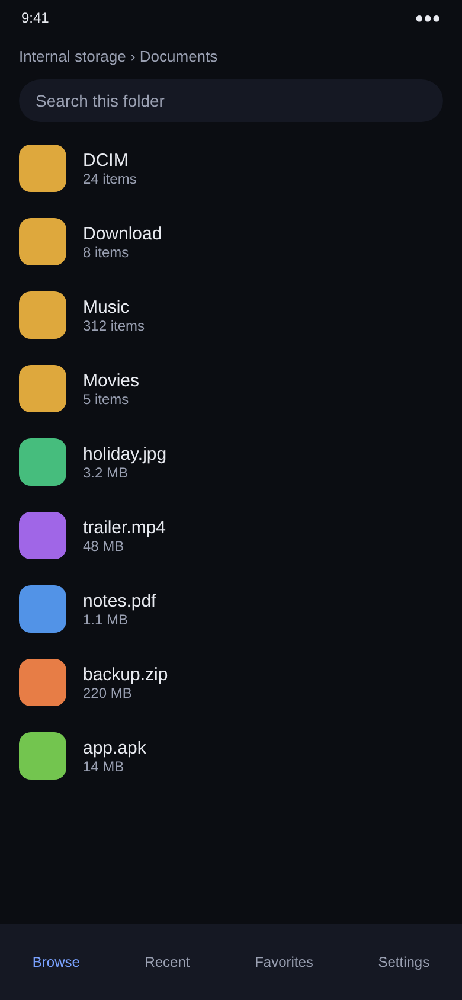
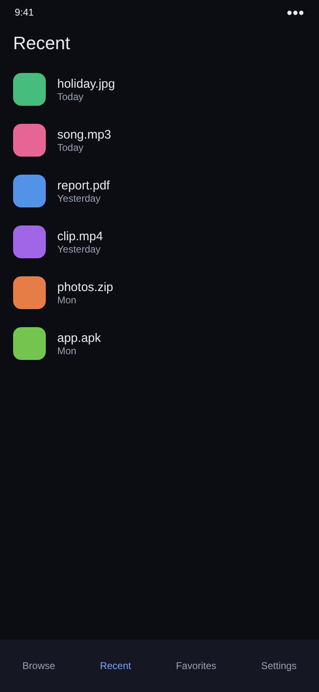
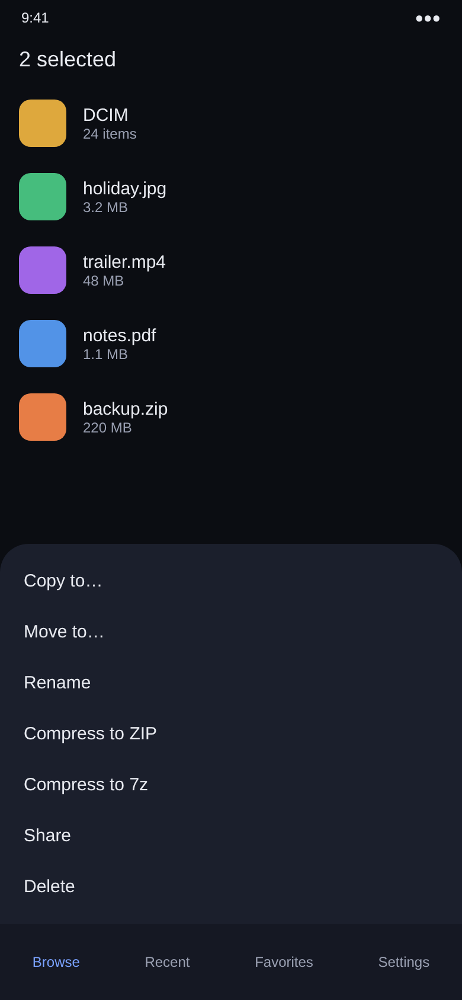
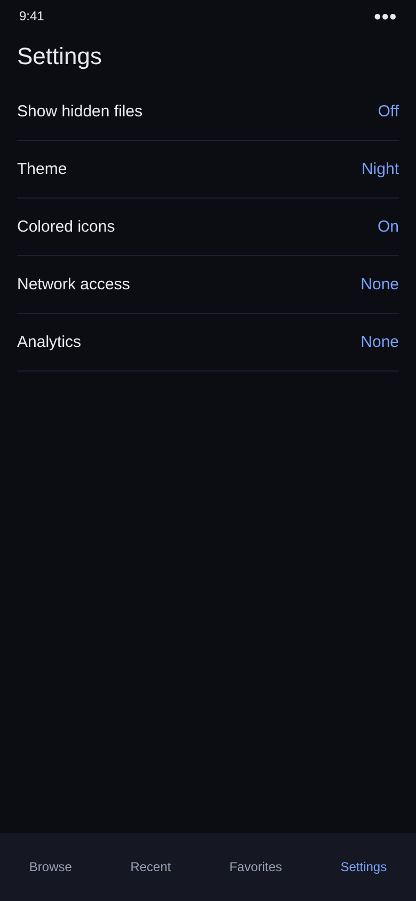

# File Manager

A private, fully offline Android file manager. Night theme, colored file-type icons, four tabs: Browse, Recent, Favorites, Settings. No network access, no analytics, no data collected.

APKs are built automatically by GitHub Actions and posted under Releases.

## Screens

These are design previews. The finished app follows this look.

<table>
  <tr>
    <td></td>
    <td></td>
    <td></td>
    <td></td>
  </tr>
</table>
